### `$ ls ~/projects`

  

### `$ cat stack.txt`

### `$ git log --stats`

  

  <picture>
    <source media="(prefers-color-scheme: dark)" srcset="https://raw.githubusercontent.com/LGYx2/LGYx2/output/snake-dark.svg" />
    
  </picture>

