```ts
const ismael = {
  role: "Backend & AI Automation Engineer",
  location: "Maputo, Mozambique",
  founder: "Nocap Cloud",
  backend: ["Java", "Spring Boot", "Node.js", "Python", "PostgreSQL"],
  automation: ["n8n", "LangChain", "webhooks"],
  infra: ["Linux", "Cloudflare R2", "Amazon S3"],
  security: ["web applications", "APIs", "Linux servers"],
};
```

### `$ ls ~/projects`

<a href="https://github.com/LGYx2/nocap-cloud">
  
</a>

### `$ cat stack.txt`


### `$ git log --stats`

<p align="center">
  
</p>

<p align="center">
  <picture>
    <source media="(prefers-color-scheme: dark)" srcset="https://raw.githubusercontent.com/LGYx2/LGYx2/output/snake-dark.svg" />
    
  </picture>
</p>


